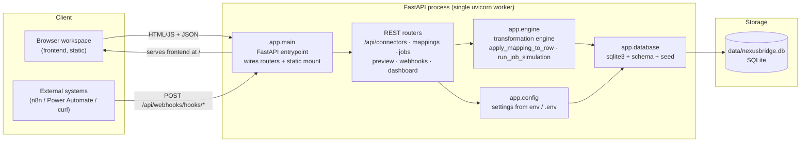
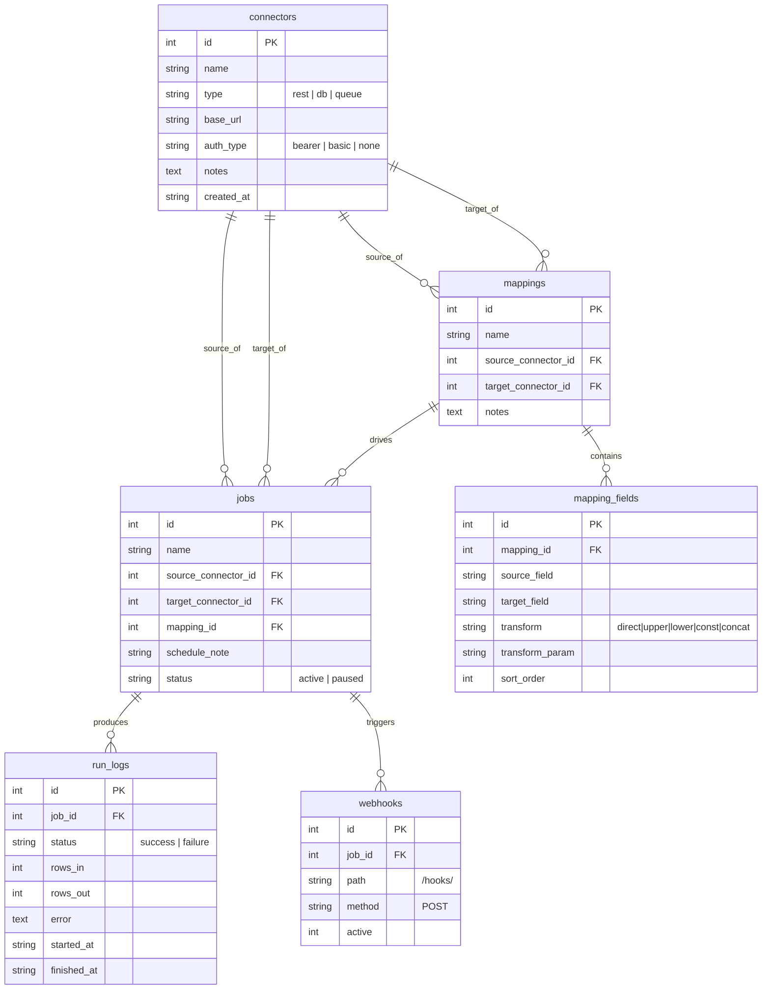

# Architecture

> Version: v0.1 · 15-11-26 · Author: SHIVAM ITCS (JARVIS)

NexusBridge is a **connector-first data-integration and AI-copilot workspace**.
The core idea: *connectors* define where data lives, *mappings* define how a
source field set is transformed into a target field set, *jobs* bind a mapping
to a source→target connector pair and run it on a schedule, *run logs* keep an
audit/governance trail of every execution, and *webhooks* let external systems
trigger a job (what a production copilot would wire into n8n/Power Automate).

This implementation simulates every integration so it runs fully offline: the
engine executes deterministic, canned sample payloads and writes the
transformed rows to the run log. There are **no network calls and no stored
secrets**.

---

## Component diagram



---

## Layered design

### 1. Connection layer — `app/database.py`
Owns the only raw state: a **SQLite** database (default
`data/nexusbridge.db`, overridable via `NEXUSBRIDGE_DB_PATH`). Responsibilities:

- Open/close connections (`get_db()`), query helpers (`query_one()`,
  `row_to_dict()`).
- Create the schema (`init_db()` → `CREATE TABLE IF NOT EXISTS …`).
- **Seed** the database on first boot with sample connectors, mappings, field
  rules, jobs, a webhook, and run logs — so the API is usable immediately.
- Use the current wall-clock for `created_at`/`started_at`/`finished_at` and
  never persist credentials (the `connectors` table only holds non-secret
  placeholders).

### 2. Domain layer — `app/models.py`
Pydantic v2 **request/response** models that enforce the API contract and
validate bounds (e.g. `rows_in: int = Field(…, ge=0)`). Includes the envelope
types used by the engine and routers:

- `ConnectorCreate/Out`, `MappingCreate/Out`, `JobCreate/Out`
- `RunResult`/`RunLogOut` (status is a `Literal["success","failure"]`)
- `DashboardOut`, `JobStats`, `WebhookCreate/Out`

### 3. Transformation layer — `app/engine.py`
Pure, deterministic, dependency-free logic:

- `normalize_field(key)` — strips whitespace so tolerated source headers map
  cleanly.
- `_transform_value(transform, param, value)` — applies one transform:
  `direct`, `upper` (on strings only), `lower`, `concat`, `const`.
- `apply_mapping_to_row(field_rules, row)` — walks the rules against a
  normalized source row, producing an output row + per-field errors (a missing
  source field yields `Missing field: <Name>` rather than a crash).
- `apply_mapping_to_sample(mapping_id)` — fetches every rule for a mapping and
  dry-runs it against canned sample payloads, *without* persisting anything.
- `run_job_simulation(job)` — the full execution path: load source/target
  connectors + mapping rules, apply the transform to sample rows, and **persist
  a `run_logs` row** (status, rows in/out, optional error, timestamps). This is
  the governance/audit trail.

> The engine never emits secrets, never touches the network, and is fully
> covered by unit tests.

### 4. Interface layer — `app/routers/*` + `app/main.py`
Six routers expose REST surface (see diagram). `app.main:app` is the single
entrypoint: it calls `init_db()` at import time (guaranteeing schema + seed
exist before the first request), includes all routers, exposes `/api/health`,
and — if `settings.frontend_dir` exists — **mounts the web workspace at `/`**
as the last route so `/api/*` and `/docs` keep precedence.

---

## Request flow: running a sync job

```
POST /api/jobs/{id}/run
   │  (routers/jobs.py)
   ▼
jobs.py opens DB, loads the job
   ▼
engine.run_job_simulation(job)
   │  • loads source & target connector rows
   │  • loads every mapping field rule (ordered by sort_order)
   │  • builds a sample payload for the source connector type
   │  • apply_mapping_to_row for each row
   ▼
writes run_logs row (status, rows_in/out, error, timestamps)
   ▼
201 RespJSON RunResult { status, rows_in, rows_out, error, output }
```

A **failure** in the middle row does not mark the whole run failed — errors are
captured per row and reported. Only an unexpected exception flips the run to
`failure`.

## Request flow: webhook write-back trigger

```
POST /api/webhooks/hooks/{path}
   │  (routers/webhooks.py)
   ▼
look up webhook row by '/hooks/' + path  →  find bound job_id  →  404 if absent
   ▼
engine.run_job_simulation(job)   (deterministic, offline)
   ▼
persist run_logs row  →  return RunResult
```

This is the local, simulated equivalent of a production copilot flow where an
external orchestrator (n8n) executes a write-back into M365/D365.

## Data model



## Design decisions worth knowing

- **Single-process deployment.** Backend + static frontend are served by one
  uvicorn process. SQLite means no separate DB server and perfectly adequate
  durability for the reference data volume.
- **Raw `sqlite3`, not SQLAlchemy.** The data-access layer is intentionally
  tiny (CRUD reads cover the whole surface); SQLAlchemy would add overhead
  without value here. Native `sqlite3` keeps the backend stdlib-light.
- **Dry-run preview is non-persisting.** `POST /api/preview/{mapping_id}` is
  the guardrail: check what a mapping would produce *before* activating it, so
  a bad rule never pollutes the audit trail.
- **Idempotent intialization.** `init_db()` uses `IF NOT EXISTS` + a
  `SELECT COUNT(*)` guard on `connectors`, so the seed only runs against a
  fresh database and never corrupts existing data.
- **Precedence of routes.** The `/` static mount is added last so `/api/*`,
  `/docs`, and `/health` always win over frontend routing.